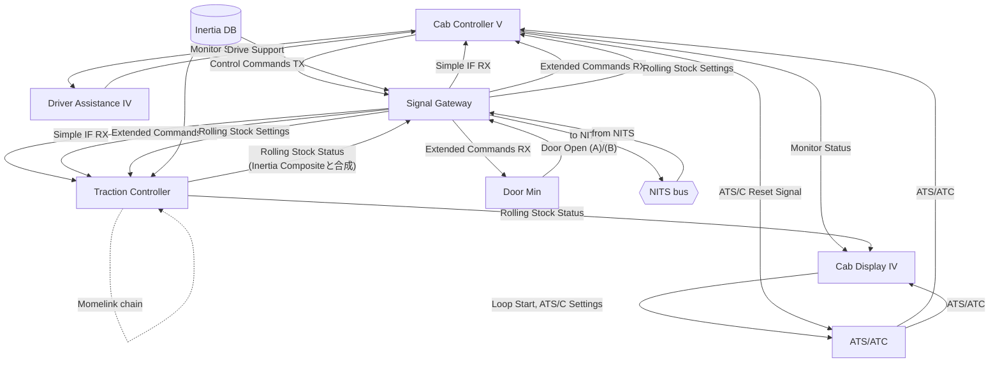

# CHUSO

中宗電鉄の各系列マイコンをまとめたディレクトリ。系列ごとに独立したプロジェクト
ディレクトリを持つ。

- `CHUSO1000_SAP_Cab_Controller/`
- `CHUSO1000_Traction_Controller/`・`CHUSO1200_Traction_Controller/`
- `CHUSO1800_Traction_Controller/`・`CHUSO1800_Traction_Controller_LuaCore/`
- `CHUSO2000_Cab_Controller_V/`・`CHUSO2000_Cab_Display_IV/`・
  `CHUSO2000_Driver_Assistance_IV/`・`CHUSO2000_Traction_Controller/`・
  `CHUSO2000_Onecar_Control/`・`CHUSO2000_Door_Min/`・`CHUSO2000_Signal_Gateway/`

## ドキュメント

| ファイル | 役割 |
|---|---|
| [`SYSTEM_SPEC.md`](./SYSTEM_SPEC.md) | 2000系列システム全体の仕様（正典）。7マイコンの役割、全体データフロー、マイコン間インターフェース、NITS通信プロトコル、制動・力行とドア制御のフロー、読み違えやすい点 |
| [`SignalComposite.md`](./SignalComposite.md) | 2000系列で使うコンポジット信号の全定義（正典）。チャンネル割付、負論理、NITSフレーム仕様 |
| [`DC_traction_motor_solver_handoff_1955-1982.md`](./DC_traction_motor_solver_handoff_1955-1982.md) | 直流主電動機と界磁制御の簡略ソルバの引き継ぎ仕様。1200系・1000系の電動機モデルの元になる |
| [`../OPEN_QUESTIONS.md`](../OPEN_QUESTIONS.md) | 仕様書の書き直しで出た、確認が済んでいない事項 |

マイコン単体の入出力と論理は、各ディレクトリの仕様書にある。

| ディレクトリ | 仕様書 |
|---|---|
| `CHUSO1000_SAP_Cab_Controller/` | [`SPEC.md`](./CHUSO1000_SAP_Cab_Controller/SPEC.md) |
| `CHUSO1000_Traction_Controller/` | [`SPEC.md`](./CHUSO1000_Traction_Controller/SPEC.md)（1200系との差分。第1フェーズの仮実装あり）、[`DESIGN_LOG.md`](./CHUSO1000_Traction_Controller/DESIGN_LOG.md) |
| `CHUSO1200_Traction_Controller/` | [`SPEC.md`](./CHUSO1200_Traction_Controller/SPEC.md)、[`DESIGN_LOG.md`](./CHUSO1200_Traction_Controller/DESIGN_LOG.md)（第1フェーズの仮実装あり。抵抗マップはダミー） |
| `CHUSO1800_Traction_Controller/` | [`SPEC.md`](./CHUSO1800_Traction_Controller/SPEC.md) |
| `CHUSO1800_Traction_Controller_LuaCore/` | [`SPEC.md`](./CHUSO1800_Traction_Controller_LuaCore/SPEC.md)、[`SIGNAL_MAP.md`](./CHUSO1800_Traction_Controller_LuaCore/SIGNAL_MAP.md) |
| `CHUSO2000_Cab_Controller_V/` | [`SPEC.md`](./CHUSO2000_Cab_Controller_V/SPEC.md) |
| `CHUSO2000_Cab_Display_IV/` | [`SPEC.md`](./CHUSO2000_Cab_Display_IV/SPEC.md) |
| `CHUSO2000_Driver_Assistance_IV/` | [`SPEC.md`](./CHUSO2000_Driver_Assistance_IV/SPEC.md) |
| `CHUSO2000_Traction_Controller/` | [`SPEC.md`](./CHUSO2000_Traction_Controller/SPEC.md) |
| `CHUSO2000_Onecar_Control/` | [`SPEC.md`](./CHUSO2000_Onecar_Control/SPEC.md) |
| `CHUSO2000_Door_Min/` | [`SPEC.md`](./CHUSO2000_Door_Min/SPEC.md) |
| `CHUSO2000_Signal_Gateway/` | [`README.md`](./CHUSO2000_Signal_Gateway/README.md) |

この README の図は、2000系列マイコン間の関連を見渡すための見取り図である。チャンネル番号、負論理、ビット単位の仕様は、上の文書で確認する。

## 2000系列マイコン間の関連

以下は2000系列マイコン間のコンポジット信号の概略図である。正典は
[`SYSTEM_SPEC.md`](./SYSTEM_SPEC.md)（特に「1.1 全体データフロー」「2. マイコン間
インターフェース」）と[`SignalComposite.md`](./SignalComposite.md)である。チャンネル割付と負論理は、この図には示さない。

この図は**電気指令ブレーキ系統の標準構成**を示すものであり、系列番号で
対象範囲が決まるわけではない。電磁直通ブレーキ系統の図は未作成。

図中の見取りだけでは分かりにくい点を以下に補足する。

- **Onecar Control**は図から省いた。前位・後位2台のCab ControllerのControl
  Commands TXを1つのCC3へ合成し、Gatewayから戻ったSimple IF RXの前後を入れ替えて
  Traction Controllerへ渡す中継役である。運転台が1つの2001・2101には搭載されて
  おらず、図の直結（Cab Controller V → Signal Gateway、Signal Gateway → Traction
  Controller）は、この2両の実車の結線そのものである。合成と反転の詳細は
  [`CHUSO2000_Onecar_Control/SPEC.md`](./CHUSO2000_Onecar_Control/SPEC.md)にある。
- **CC3(≒Control Commands TX)とSimple IF RXは同じデータの往復であり、並存する
  2経路ではない。** Gateway→NITS bus→Gatewayを経て戻ってきた時点で名前が
  Simple IF RXに変わる。
- **Cab Display IV → ATS/ATC**の`Loop Start, ATS/C Settings`は、2001・2101の
  結線では、ATS/ATCの`ATS/ATC Activate`へつながる。Cab Controller Vの
  `Drive Loop`/`Settings Loop`へは入らない（その2つは`instrument_display`から来る）。
  図の矢印`CD → CC`は、実車の結線にない。
- **Door Min**はCC3を直接受け取らない。開扉指令はGatewayの`Extended Commands RX`
  (Door_Minでの別名`NITS Ext. Input`)経由で受け、状態は`Door Open (A)/(B)`として
  Gatewayへ返す。出力は`Door is Open`1系統のみで、2001・2101では車に2台載り、
  `Door Side`が既定の1台がGatewayの`Door Open (A)`、`Door Side`=1の1台が
  `Door Open (B)`へつながる（実車の結線で確認済み）。
- **Traction Controllerの自己ループ（Momelink, ID=1911）**は、異なるマイコン間
  ではなく同じTraction Controllerを積んだM車とT車の間を結ぶ専用線である。T車は
  ローカルに電動機計算を持たず、M車からMomelink経由で架線電圧・電流・空気
  ブレーキ分担（遅れ込め制御。電気制動の実際の効きに合わせて空気ブレーキ側の
  負担を配分する仕組み）を受け取る。詳細は[`SYSTEM_SPEC.md`](./SYSTEM_SPEC.md)
  §4「制動・力行制御フロー」にある。
- **Inertia Composite**は車両内の別マイコンから供給されるため、図では
  データストア(円柱)として表した。Signal GatewayとTraction Controllerが独立に
  受け取る（Traction Controller側は`Inertia Composite Input`という別ポート名）。
  供給元は、2001・2101に載っている`Inertia Composite`マイコン（出力1本が両方へ
  つながる）。このマイコンのプロジェクトは、このリポジトリにまだない。
- **ATS/ATC**はこの7マイコンに含まれない別マイコンで、Cab Controller V・
  Cab Display IVへ`ATS/ATC`信号を供給し、Cab Controller Vから`ATS/C Reset Signal`
  を受け取る。まだこのリポジトリに実体を持たないため、図では他と区別して示した。
